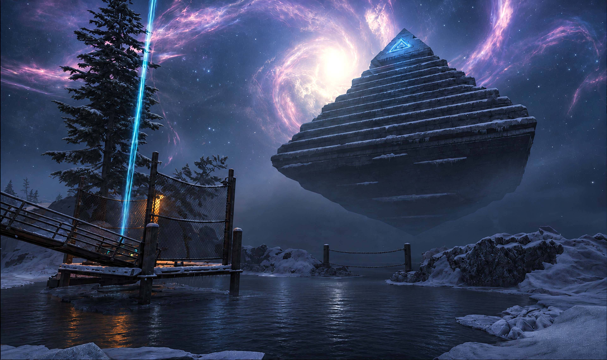
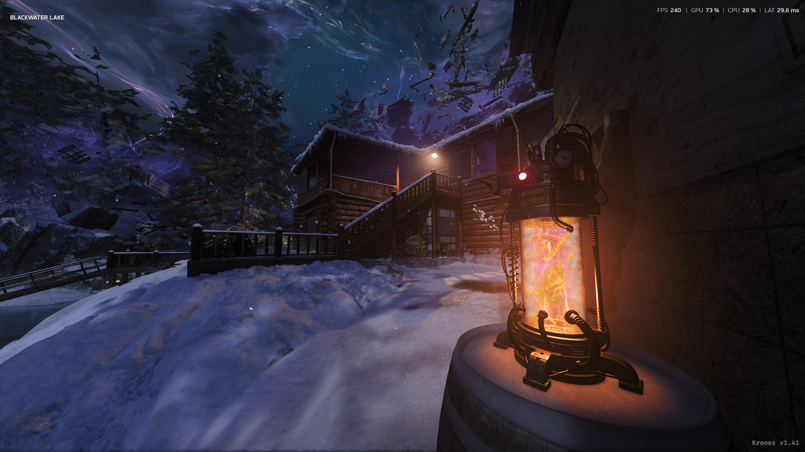
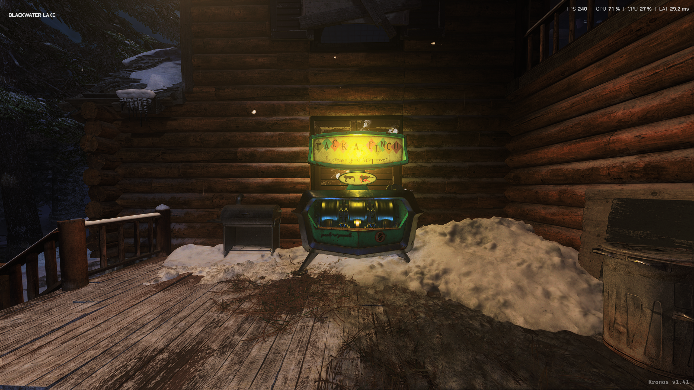
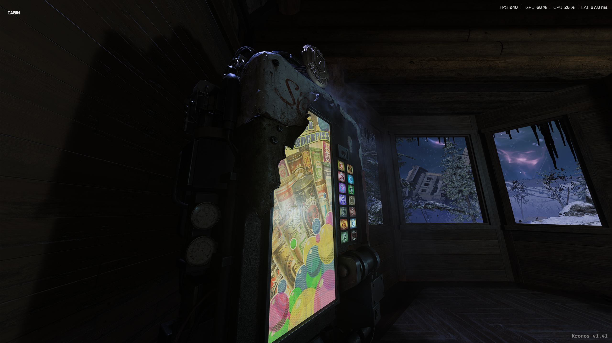
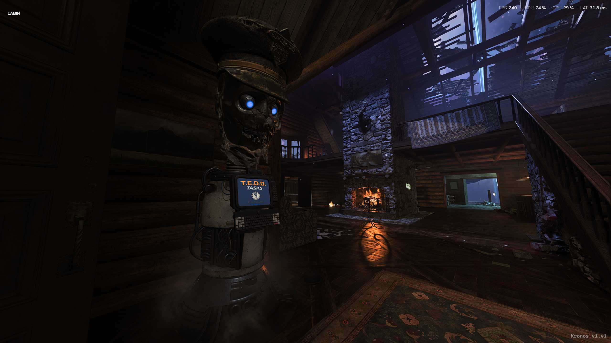
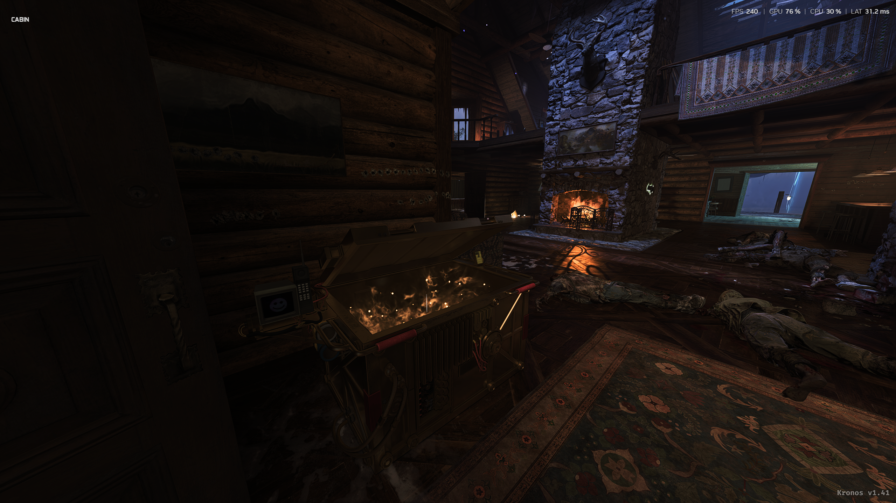

# Blackwater Lake

**The first ever Custom Survival map for Black Ops 7 Zombies (Kronos)**
by DellxCell (The Hamster)

## Modes

| Mode | Where to find it | Players |
| --- | --- | --- |
| Survival | Zombies > Survival > Blackwater Lake | Solo, or a squad of up to 4 |
| Cursed Survival | Zombies > Cursed Survival > Blackwater Lake | Solo, or a squad of up to 4 |

## What's at the lake

### Rampage Inducer

The Rampage Inducer sits on the barrel by the cabin wall. Turn it on when you want the rounds to speed up.

### Pack-a-Punch on the cabin deck

Upgrade your weapons out on the snowy deck of the cabin.

### Der Wunderfizz

Grab perks from the Wunderfizz machine inside the cabin.

### T.E.D.D. Tasks

In Cursed Survival, T.E.D.D. Tasks run from the console at the lake cabin. Start a task, finish it, and come back for your reward.

Your reward is waiting in the T.E.D.D. reward box in the cabin's main room.

### Also at the lake

- **Restore Power:** the native objective tracker is enabled on this map, so the Restore Power objective appears.
- **Mr. Peeks:** in Cursed Survival, Mr. Peeks shows up above the cabin entrance. Shoot him to drop an egg.
- **Custom loading intro:** a 15-second picture intro of the cabin, pool room, living room, pyramid and cabin entrance plays while the map loads.

## Install

1. Close Black Ops 7 and KronosLauncher completely.
2. Copy the `Assets`, `custom_scripts` and `blackwater_rampage` folders into `C:\Kronos\cod25\kronos`.
3. Windows will tell you that some files already exist. **This is normal.** Choose **Replace the files in the destination**. If you get the "Which files do you want to keep?" window instead, tick **Files from Blackwater Lake** at the top so every file on the left is selected, then click **Continue**.
4. Launch the game through Kronos as usual.

> [!NOTE]
> **Replacing Kronos files is expected.** Blackwater Lake adds its map entries to four existing Kronos files, so those four files get replaced:
>
> - `Assets\Lua\zm_local_start_post.lua`
> - `Assets\Lua\csm_mayhem_relic_post.lua`
> - `Assets\Lua\ui\LUIFPSCounter.lua`
> - `custom_scripts\csm_survival.gscc`
>
> You don't need to back them up. To put the original Kronos files back at any time, press **Update Now** in the Kronos launcher. After that, Blackwater Lake won't show up in the menu until you copy its files in again.

No DLLs or system files are involved. Everything stays inside the Kronos folder. Full install, removal and technical notes are in [README.txt](../README.txt).

## Known issues

- Avoid Save & Quit on this map for now. Saving and resuming at the lake hasn't been fully tested.
- Blackwater saves share the Ashes of the Damned Survival save slot, so saving on one map replaces the save on the other.
- Co-op guests may still see "Ashes of the Damned" on their loading screen and scoreboard.
