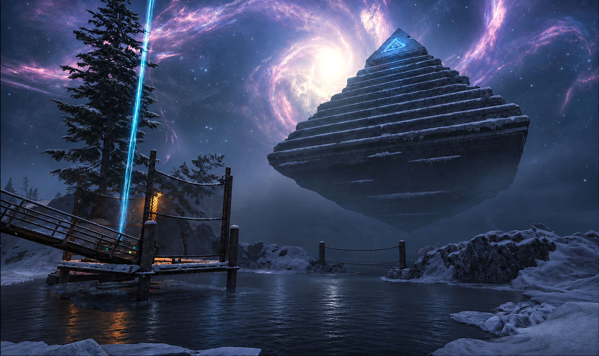
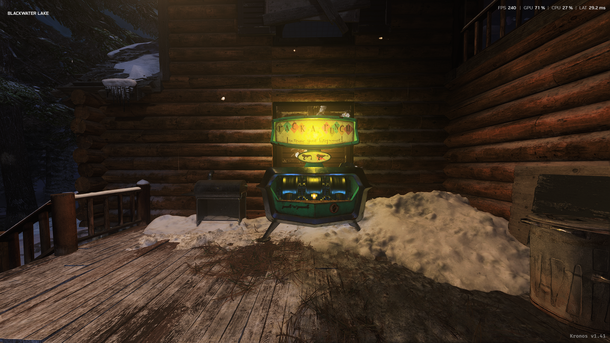
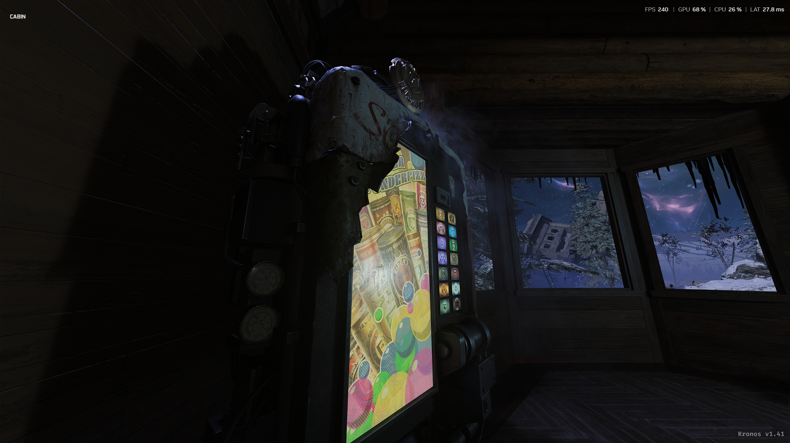
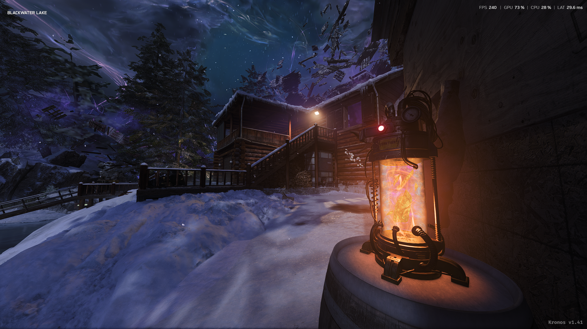
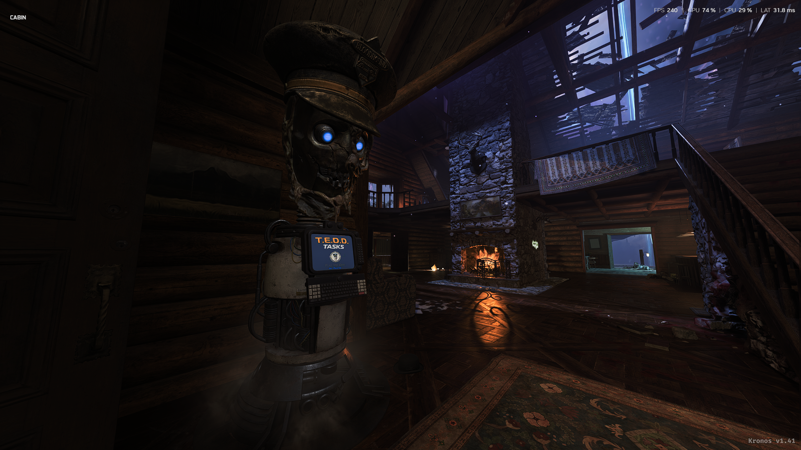
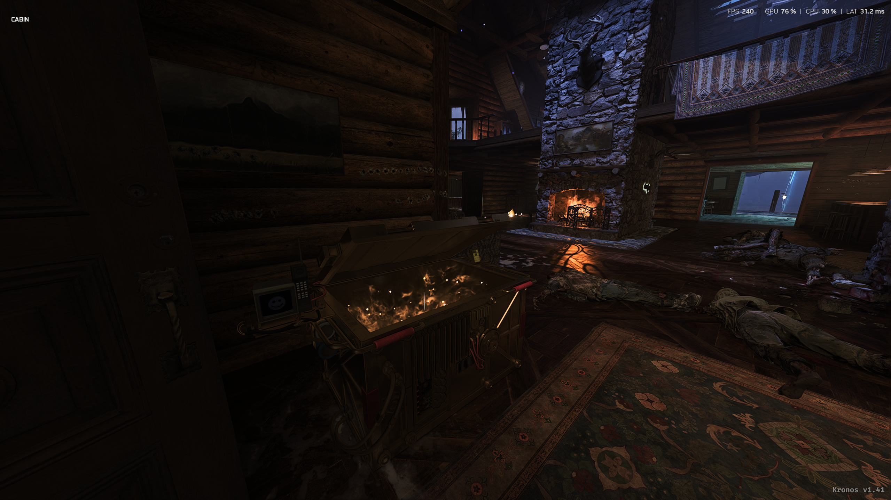

# Blackwater Lake

The first ever Custom Survival map for **Black Ops 7 Zombies**, made for **Kronos**.

Survive at the lake, cabin and cliffs of Ashes of the Damned, in Survival or Cursed Survival, solo or with a squad of up to 4.

**Website:** https://dellxcell.github.io/Blackwater-Lake/

## Download

Get the zip from **[Releases](https://github.com/DellxCell/Blackwater-Lake/releases)** and follow [Install](#install) below. It's also submitted to the Kronos Workshop ([pull request](https://github.com/Divity/kronos-data/pull/51)); once it's approved you can install it from there.

| Mode | Where to find it | Players |
| --- | --- | --- |
| Survival | Zombies > Survival > Blackwater Lake | Solo, or a squad of up to 4 |
| Cursed Survival | Zombies > Cursed Survival > Blackwater Lake | Solo, or a squad of up to 4 |

## Features

**At the lake**
- **Pack-a-Punch** out on the snowy deck of the cabin
- **Der Wunderfizz** inside the cabin
- **Rampage Inducer** on the barrel by the cabin wall: turn it on when you want the rounds to speed up
- **T.E.D.D. Tasks** in Cursed Survival, from the console at the lake cabin; your reward waits in the T.E.D.D. reward box in the cabin's main room
- **Exfil:** after a successful exfil the match ends and moves on by itself, like on Kronos' own Survival maps

**Also**
- **Mister Peeks Mayhem:** pick the Mr. Peeks relic in Cursed Survival and Kronos' Mister Peeks Mayhem runs at the lake. Mr. Peeks shows up above the cabin entrance; shoot him to drop an egg
- **Restore Power:** the Restore Power objective shows on the HUD, with its timer during the pump and vines step
- **Klaus:** summon Klaus at the lake and he fights alongside you
- **Custom loading intro:** a 15-second picture intro of the cabin, pool room, living room, pyramid and cabin entrance plays while the map loads

## Screenshots

| Pack-a-Punch on the cabin deck | Der Wunderfizz inside the cabin |
| --- | --- |
|  |  |

| Rampage Inducer | T.E.D.D. Tasks console |
| --- | --- |
|  |  |

## Requirements

- Black Ops 7 with **Kronos** set up (run the Kronos launcher at least once)
- No other files needed: it doesn't replace any Kronos or game files

## Install

**From the Kronos Workshop:** once it's approved, find Blackwater Lake and install it.

**By hand:**

1. Download **[Blackwater-Lake-1.0.zip](https://github.com/DellxCell/Blackwater-Lake/releases/download/v1.0/Blackwater-Lake-1.0.zip)** from the [latest release](https://github.com/DellxCell/Blackwater-Lake/releases/latest).
2. Close Black Ops 7 and KronosLauncher completely.
3. Extract the zip into `C:\Kronos\cod25\kronos\mods`. You should end up with `C:\Kronos\cod25\kronos\mods\blackwater_lake\mod.json`, plus the `scripts`, `lua` and `images` folders next to it.
4. Launch the game through Kronos as usual.

The release also lists the mod's files one by one, without folders. Those are for the Kronos Workshop, which puts each file in its folder for you. To install by hand, use the zip.

> [!NOTE]
> Blackwater Lake is a Kronos mod in its own folder. It doesn't replace any Kronos or game files, so nothing shows as "Outdated" in the launcher, and no DLLs or system files are involved. To remove it, delete `C:\Kronos\cod25\kronos\mods\blackwater_lake`.

> [!IMPORTANT]
> **Upgrading from the old version (the one you copied into the Kronos folder, released November 8):** first press **Update Now** in the Kronos launcher to put the original Kronos files back, then delete these old Blackwater files from `C:\Kronos\cod25\kronos`, and install the mod as above:
>
> - `custom_scripts\zm_blackwater_lake.gsc` and `custom_scripts\zm_blackwater_lake.gscc`
> - `Assets\Lua\blackwater_intro_post.lua`
> - `Assets\Images\blackwater_intro_01.png` to `blackwater_intro_05.png`, `blackwater_lake_save.png` and `blackwater_lake_save_tile.png`
>
> If the old files stay, Kronos skips the mod's copies.

## Known issues

- **Avoid Save & Quit** on this map. Saving and resuming at the lake isn't supported yet; a Blackwater save may resume as Ashes of the Damned.
- Squad play hasn't been fully tested yet.
- Dropped loot showing a grey rarity outline in Cursed Survival also happens on a clean Kronos install without any mods, so it isn't caused by Blackwater Lake. The [Cursed Survival Rarity Outline Fix](https://github.com/DellxCell/Cursed-Survival-Rarity-Outline-Fix) fixes it.

---

Made by **DellxCell** (The Hamster).
